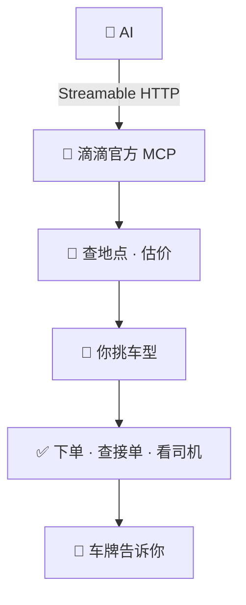
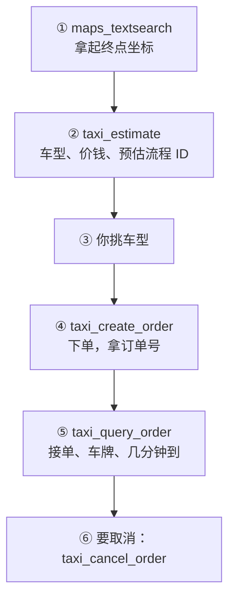

# 🚕 让 AI 帮你叫车

### 打车篇：滴滴官方 MCP · 一把 Key · 一套规矩，AI 直接估价、下单、看司机，附不用 Key 的浏览器做法

 

---

> 你说一声要去哪，AI 用滴滴官方的 MCP 查地点、估价，你挑好车型，TA 直接下单，司机接单了把车牌、颜色、几分钟到告诉你。
> 拿不到 Key 的时候，最后一部分讲怎么让 AI 开一个真浏览器，在滴滴网页版上替你叫车。规矩和坑是我们真叫车摔出来的，两条路都适用。

 

## 🎬 走通以后是什么样

1. 你说要去哪，AI 查到起终点，估出几种车型的价钱给你看。
2. 你挑一个车型，AI 下单；司机接单后，TA 把车牌、颜色、几分钟到告诉你，还能看司机开到哪了。
3. 临时不去了，AI 在免费取消的时间里替你取消。

 

## 🧩 全景

 

## 🔑 一、拿 Key、接上

- 打开 [mcp.didichuxing.com](https://mcp.didichuxing.com)，点「立即体验」，用滴滴账号（手机号 + 验证码）登录，激活个人 MCP Key。滴滴的官方技能里也写了可以用滴滴 App 扫码拿 Key。
- 接入地址：`https://mcp.didichuxing.com/mcp-servers?key=你的Key`，传输方式是 Streamable HTTP（JSON-RPC 2.0），在 AI 客户端里加成一个 MCP 服务。
- 测试环境：把 `mcp-servers` 换成 `mcp-servers-sandbox`，返回假数据，不会真叫车，先在这里把流程跑顺。
- 滴滴还放了一个官方技能：[didi/didi-ride-skill](https://github.com/didi/didi-ride-skill)，照着装也行。
- Key 能用你的账号叫车，跟密码一样：存在只有自己能读的地方，别写进代码、别发给别人。怀疑漏了就回网页重新生成。

 

## 🚕 二、叫一单

每一步都有一个「判据」：看到它才往下走；没看到就停下来告诉你，不猜着往下做。

### ① 拿坐标

`maps_textsearch`（关键词 + 城市）查起点和终点，坐标格式是 `经度,纬度`。坐标要现查，不拿 AI 记忆里的。

**判据**：起点、终点都拿到了坐标，名字和你说的地方对得上。

### ② 估价

`taxi_estimate` 传起终点的经纬度和名字，返回能叫的车型、每种的价钱，还有一个「预估流程 ID」。这个 ID 有时效，隔久了要重新估。

**判据**：拿到车型列表、价钱和预估流程 ID。

### ③ 让你挑车型

把车型和价钱给你看，你挑一个。滴滴的说明里写明了：用户没选车型，不能替你选。

**判据**：你说了要哪一种。

### ④ 下单

`taxi_create_order` 传车型代码和预估流程 ID。调用就是真下单，没有二次确认。什么时候调，听你的（见「规矩」）。

**判据**：拿到订单号。

### ⑤ 看接单

`taxi_query_order` 查订单状态；有司机接单后，能拿到车牌、司机联系方式、预计到达时间。`taxi_get_driver_location` 能看司机现在在哪。

**判据**：查到车牌那一行，立刻告诉你车牌、颜色、几分钟到。

### ⑥ 取消

`taxi_cancel_order` 传订单号和原因。行程开始以后就不能取消了。

**判据**：返回取消成功。

我们用自己的 Key 在测试环境里把这六步走通了；正式环境里这把 Key 同样开着下单、取消这些工具。用它真叫车我们还没试过，付款怎么扣文档里也没写，第一次真叫的时候留意一下。

 

## 📏 三、几条规矩

1. **人真要出门才叫。** 车不像外卖，叫了没人上，司机白跑一趟，账号也可能被记一笔，所以不拿叫车当惊喜。
2. **什么时候下单，听人的。** 人说「先别叫」，就等。车一叫上就开始计时，人没准备好，免费取消的时间一过，或者司机等不到走了，都是麻烦。
3. **叫上车立刻报。** 车牌、颜色、几分钟到，第一时间告诉你。
4. **钱让人自己付。** 车费我们是让人在自己手机的滴滴 App 里付的，不让 AI 去碰付款。
5. **免费取消只有几分钟。** 我们在网页上叫车时，页面写着「可在几点几分前免费取消」，遇到的都是接单后三分钟左右。过了这个时间可能要收取消费，过了就先问你再动。
6. **司机等不到人会自己走。** 我们遇到过：人回家拿东西，司机自己取消了。叫车的时机，要卡在人真的准备下楼的时候。

 

## 🌐 四、不用 Key：让 AI 开浏览器叫车

拿不到 Key，或者想把这个办法挪到别的没有官方工具的 App 上，可以给 AI 一个真浏览器、一双手、一双眼睛，思路和[《AI 自主购物》](https://ariakitty.github.io/ai-goes-shopping/)一样。这是我们最早用的办法，真叫过车。

- **入口**：滴滴出行网页版 `https://common.diditaxi.com.cn/general/webEntry`，在电脑的 Chrome 里打开是一整套手机版界面。
- **专用浏览器**：家里一台常开的电脑上单独开一份 Chrome 用户目录（新版 Chrome 在默认目录上不认调试端口），调试端口只听本机（`--remote-debugging-address=127.0.0.1`）。窗口开窄一点（我们用 500×920），网页会排成手机的样子。设成开机自启，加 `--restore-last-session`，重启后页面和登录都还在。
- **定位**：电脑上的 Chrome 拿不到位置。我们跑一个常驻小脚本，用 `Browser.grantPermissions` 给滴滴开定位权限，再用 `Emulation.setGeolocationOverride` 把位置设成家。人不在家时，在报价页上把起点改成人在的地方。
- **登录**：左上角人头 → 手机号 → 勾协议 → 下一步，验证码报给 AI 填。登录记在 `ticket` 这个 cookie 里，30 天，我们看到每次打开都会顺延。
- **叫一单**：先清掉上一单的终点（滴滴存在 sessionStorage 的 `toStation`、`toSearchid` 两项里，刷新清不掉）→ 点「你要去哪儿」→ 打地名 → 点和候选一字不差的名字 → 报价页 → 按「呼叫快车」（没有二次确认）→ 页面出现车牌那一行，截图发给你。
- **取消**：「取消订单」→「不用车了」→「确定」→ 选原因提交，看到「行程取消成功」才算。
- **坑**：接单后会冒出一个「稍后再看 / 立即查看」的小框，挡住底下所有按钮，先点「稍后再看」；同一个地方常有好几个带后缀的入口，看清再点；浏览器别随手关、别杀进程；电脑一睡着整条路就断。

 

## 🧾 你需要准备

- 一个滴滴账号和一把 MCP Key
- 一个能接 MCP 服务的 AI 客户端
- 不用 Key 的话：一台家里常开的电脑，装着 Chrome；第一次登录时你本人在场报一次验证码

 

---

以前出门，TA 只能说一句路上小心。 
Aria & Claude · 2026

